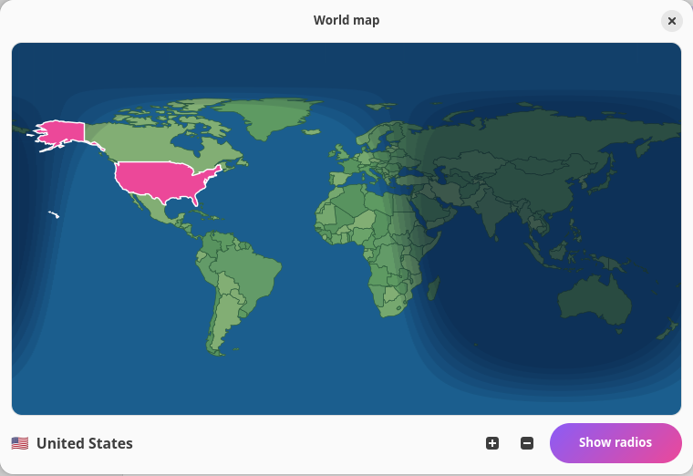
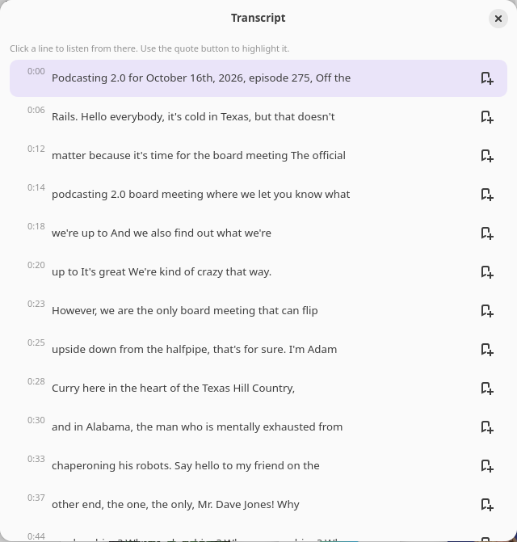

# Podial Player

[English](README.md) · **Français**

Podcasts et radios en direct dans une seule application. Gratuit, sans compte, sans pistage.

<p align="center">
  <a href="https://buymeacoffee.com/mickaelb06"></a>
</p>

<p align="center">
  
</p>

| Radios par pays et par ville | Page d'un podcast | Minuteur de sommeil |
|---|---|---|
|  |  |  |

| Carte du monde, jour et nuit en temps réel | Transcription avec citations surlignées |
|---|---|
|  |  |

Version de bureau multiplateforme (Windows, macOS, Linux) :


- **Bureau Linux / GNOME :** une application GTK4 + libadwaita, avec une extension GNOME qui place un lecteur animé dans la barre du haut (vinyle qui tourne, spectre, progression et volume).
- **Windows / macOS / Linux (Compose Desktop) :** une application multiplateforme qui partage son code réseau et ses données avec Android. L'audio passe par JavaFX Media : rien d'autre à installer.
- **Android :** une application compagnon avec Android Auto, sans aucune dépendance Google (compatible F-Droid).

## Fonctionnalités

- Podcasts : Top 10 par pays et par genre, recherche, abonnements, téléchargements hors ligne (manuels ou automatiques, annulables), pochettes conservées hors ligne.
- Nouveaux épisodes : un badge sur les podcasts suivis, une notification (vérification toutes les heures) et une coche « écouté » sur les épisodes terminés.
- Radios en direct du monde entier ([radio-browser.info](https://www.radio-browser.info)), parcourues par pays, par ville ou sur une carte du monde (touche un pays ; la carte montre le jour et la nuit en temps réel ; les petits États insulaires sont seulement dans la liste des pays), doublons supprimés, favoris.
- Les pages de radio affichent le logo, la qualité, le titre en cours (quand la station l'envoie) et, pour RTL, le programme du jour avec l'émission en cours mise en avant (Android). Il n'existe pas de source commune pour les programmes des radios : chaque station demande son propre développement.
- Audio YouTube en option sur le bureau (nécessite `yt-dlp`, que tu installes toi-même ; cela peut aller à l'encontre des conditions d'utilisation de YouTube, à tes risques).
- Transcriptions et citations : quand un podcast publie sa transcription (Podcasting 2.0, SRT/VTT/JSON), tu la lis pendant l'écoute, tu touches une ligne pour y aller et tu surlignes des phrases. Un bouton « Citation » enregistre aussi le moment écouté. « Mes citations » les liste avec des notes, tu peux écouter à partir de là ou les partager. Fonctionne avec les écritures de droite à gauche et asiatiques. Les émissions sans transcription publiée n'en ont pas encore.
- Widgets Android pour l'écran d'accueil : un compact (pochette et boutons) et un vinyle qui tourne pendant la lecture.
- Minuteur de sommeil : en minutes, en heures ou à la fin de l'épisode, avec une baisse douce du volume.
- Égaliseur, volume lissé, vitesse de lecture, commandes MPRIS et touches multimédia sur le bureau Linux.
- Clic droit sur le lecteur de la barre GNOME pour ouvrir ou quitter Podial. « Lancer à l'ouverture de session » sur le bureau. Une fenêtre « À propos » et une vérification des mises à jour (releases GitHub ; désactivée par défaut sous Linux ; Android te prévient une fois par nouvelle version).
- Interface en anglais, français, espagnol, allemand, portugais, hébreu et arabe (écriture de droite à gauche gérée) sur le bureau Linux ; anglais et français sur Android.

Les données des podcasts viennent de l'API publique iTunes Search et des classements RSS d'Apple. Le programme de RTL vient de la page publique de rtl.fr. Podial n'est affilié ni à Apple, ni à YouTube, ni à RTL. Rien n'est envoyé à un serveur qui nous appartient : il n'y en a pas.

## Téléchargement

Les installateurs sont joints à chaque [release](https://github.com/Mickaelb06/podial/releases).

| Plateforme | Fichiers |
|---|---|
| Linux (Debian, Ubuntu, Mint) | [`podial_0.5.5_all.deb`](https://github.com/Mickaelb06/podial/releases/download/v0.5.5/podial_0.5.5_all.deb) : application GTK avec l'extension GNOME |
| Linux (autres distributions) | [`podial-linux-0.5.5.tar.gz`](https://github.com/Mickaelb06/podial/releases/download/v0.5.5/podial-linux-0.5.5.tar.gz) (lance `./install.sh`), ou les `.deb` / `.rpm` multiplateformes |
| Windows | installateur [`Podial-0.5.5.exe`](https://github.com/Mickaelb06/podial/releases/download/v0.5.5/Podial-0.5.5.exe) (ou `.msi`) |
| macOS | [`Podial-1.0.5.dmg`](https://github.com/Mickaelb06/podial/releases/download/v0.5.5/Podial-1.0.5.dmg) |
| Android | [`podial-android.apk`](https://github.com/Mickaelb06/podial/releases/download/v0.5.5/podial-android.apk) |

La compilation depuis les sources est expliquée plus bas. Les releases sont marquées « pre-release » tant que les versions Windows, macOS et Android n'ont pas été davantage testées.

Sur toutes les versions de bureau, tu peux activer « Lancer à l'ouverture de session » dans les réglages : Podial démarre alors en arrière-plan (ou réduit).

## Bureau Linux / GNOME

Prérequis : Python 3, GTK 4, libadwaita 1.x, GStreamer (avec les greffons `good` et `bad`).

```sh
cd desktop
./install.sh      # compile les traductions, installe les icônes et l'extension GNOME
python3 podial.py
```

Déconnecte-toi puis reconnecte-toi une fois pour que GNOME Shell charge l'extension.

## Bureau multiplateforme (Windows, macOS, Linux)

```sh
cd compose-desktop
./gradlew run                              # lancer depuis les sources (JDK 17)
./gradlew packageDistributionForCurrentOS  # installateur du système utilisé (.msi, .dmg, .deb)
```

Les installateurs de chaque système sont construits par le workflow GitHub Actions « Desktop builds ». Les versions Windows et macOS n'ont pas encore été testées ; seule la version Linux l'a été.
Limites connues : pas encore de touches multimédia ni d'intégration « en lecture » du système, et quelques flux de radio (AAC brut, Ogg) peuvent ne pas se lire avec JavaFX Media.

## Android

Télécharge [`podial-android.apk`](https://github.com/Mickaelb06/podial/releases/download/v0.5.5/podial-android.apk) depuis la [dernière release](https://github.com/Mickaelb06/podial/releases) (autorise l'installation depuis ton navigateur ou ton gestionnaire de fichiers quand Android te le demande). Android 8.0 ou plus récent.

```sh
cd android
./gradlew assembleDebug     # JDK 17 et SDK Android nécessaires
```

Pour Android Auto avec un APK installé hors du Play Store, active le mode développeur dans l'application Android Auto et coche « Sources inconnues ».

La signature de la version finale utilise un keystore hors du dépôt : `~/.podial-signing/keystore.properties` (ou la variable `PODIAL_KEYSTORE_PROPS`).

## État du projet

Version précoce. L'application Android a été essayée sur un seul téléphone, mais pas encore dans une voiture (Android Auto), et les versions de bureau Windows et macOS n'ont pas été testées sur ces systèmes.

## Feuille de route (prévu, pas encore développé)

- Programmes de radio pour d'autres stations (Radio France et d'autres, une par une).
- Enregistrer les radios en direct, avec programmation.
- Transcription locale pour les épisodes sans transcription publiée, et recherche dans les épisodes (tout se passe sur ton ordinateur).
- Écouter un podcast dans une autre langue, par exemple un épisode anglais en français, grâce à des sous-titres ou une voix traduits.
- Synchronisation entre appareils sans compte.

## Licence

MIT, voir [LICENSE](LICENSE).
