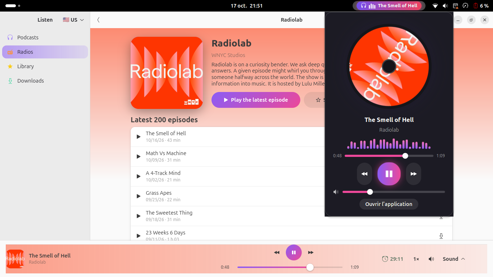
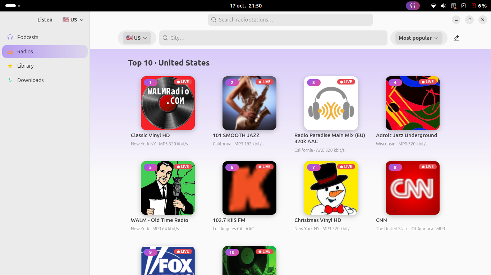
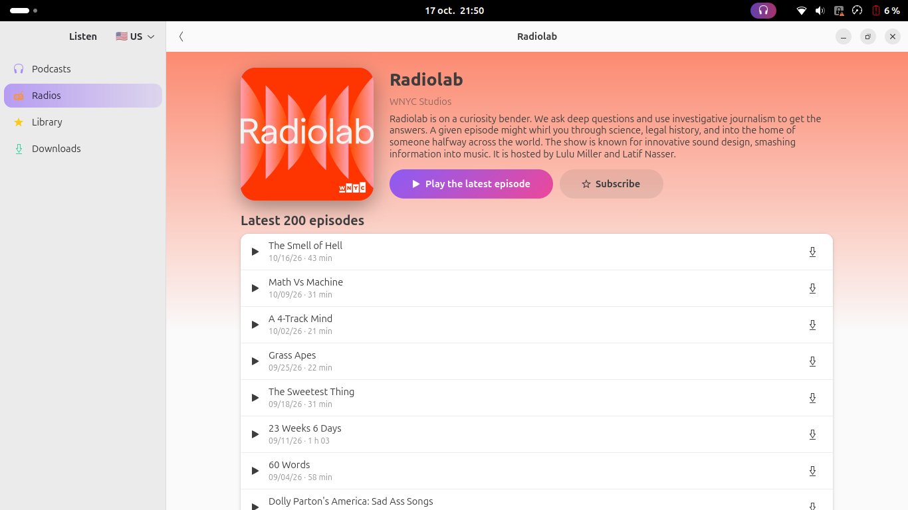
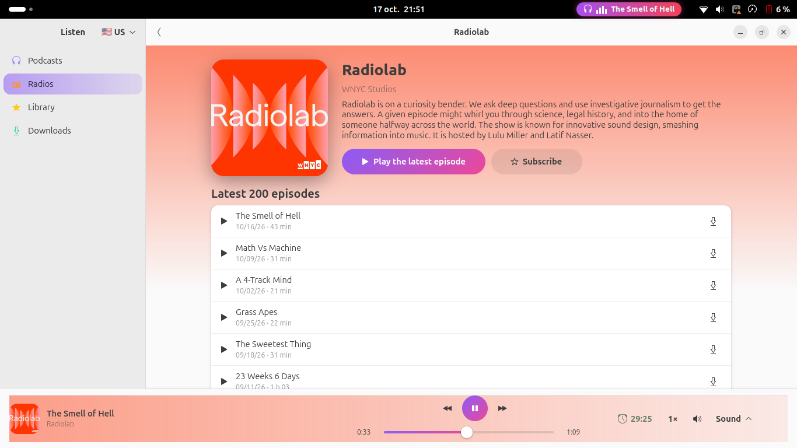
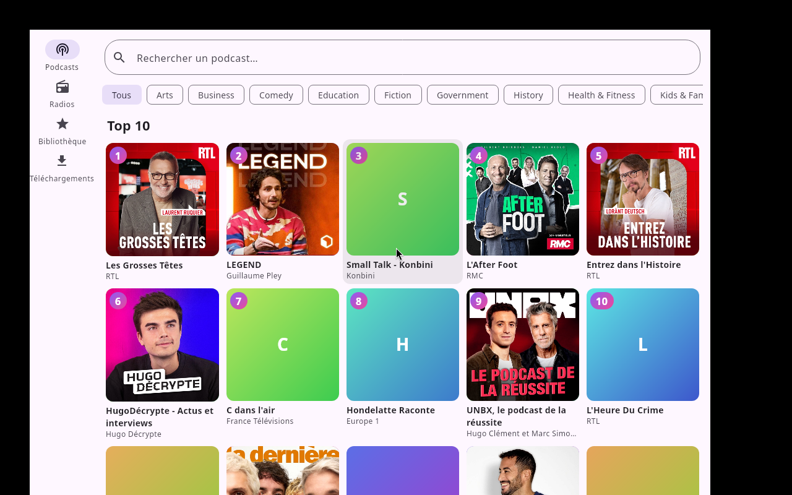

# Podial

**English** · [Français](README.fr.md)

Podcasts and live radio in one app. Free, no account, no tracking.

<p align="center">
  
</p>

| Radios by country and city | Podcast page | Sleep timer |
|---|---|---|
|  |  |  |

Cross-platform desktop version (Windows, macOS, Linux):



- **Desktop (Linux / GNOME):** a GTK4 + libadwaita app, plus a GNOME Shell extension that puts an animated player in the top bar (spinning vinyl, spectrum, progress and volume).
- **Windows / macOS / Linux (Compose Desktop):** a cross-platform app sharing its network and data code with Android. Audio uses JavaFX Media, so nothing else to install.
- **Android:** a companion app with Android Auto support, built without any Google dependency (F-Droid friendly).

## Features

- Podcasts: top 10 by country and genre, search, subscriptions, offline downloads (manual or automatic), cover art kept offline.
- Live radio from all countries ([radio-browser.info](https://www.radio-browser.info)), browse by country and city, duplicates removed, favorites.
- Optional YouTube audio on desktop (requires `yt-dlp`, which you install yourself; this may go against YouTube's terms of service, use at your own risk).
- Sleep timer: in minutes, hours, or at the end of the episode, with a gentle volume fade.
- Equalizer, smooth volume, playback speed, MPRIS controls and media keys on desktop.
- Interface in English, French, Spanish, German, Portuguese, Hebrew and Arabic (right-to-left supported) on desktop; English and French on Android.

Podcast data comes from the public iTunes Search API and Apple RSS charts. Nothing is sent to any server of ours: there is none.

## Desktop

Requirements: Python 3, GTK 4, libadwaita 1.x, GStreamer (with the `good` and `bad` plugin sets).

```sh
cd desktop
./install.sh      # builds translations, installs icons and the GNOME Shell extension
python3 podial.py
```

Log out and back in once so GNOME Shell loads the extension.

## Cross-platform desktop (Windows, macOS, Linux)

```sh
cd compose-desktop
./gradlew run                              # run from source (JDK 17)
./gradlew packageDistributionForCurrentOS  # installer for the OS you are on (.msi, .dmg, .deb)
```

Installers for each system are built by the GitHub Actions workflow `Desktop builds`. The Windows and macOS builds have not been tested yet; only Linux has.
Known limits: no media keys / system "now playing" integration yet, and a few radio streams (e.g. raw AAC or Ogg) may not play with JavaFX Media.

## Android

```sh
cd android
./gradlew assembleDebug     # needs JDK 17 and the Android SDK
```

For Android Auto with an APK installed outside the Play Store, enable developer mode in the Android Auto app and tick "Unknown sources".

Release signing uses a keystore outside the repository: `~/.podial-signing/keystore.properties` (or the `PODIAL_KEYSTORE_PROPS` variable).

## Status

Early version. The Android app has not yet been tested on a real device or in a car, and the Windows/macOS desktop builds have not been tested on those systems.

## License

MIT, see [LICENSE](LICENSE).
